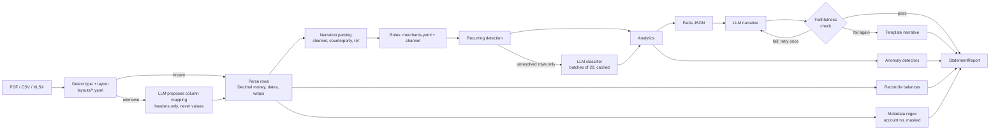

# bank-statement-intel

AI-assisted bank statement analyzer. Upload a PDF / CSV / XLSX statement and get structured transactions,
categories, spending summaries, anomaly flags and a short financial summary, via a FastAPI backend and a
web UI.

> **All data in this repo is synthetic.** Fictional banks, people, account numbers and IFSC codes. No real
> banking data is used anywhere.

| | |
|---|---|
| Screenshots | _TODO: add `docs/screenshots/*.png`_ |
| Demo video | _TODO: add link_ |
| Live API / UI | _TODO: add Render/Railway URL after deploying_ |

## The problem

Bank statements arrive in inconsistent layouts: different column structures, Indian number formats
(`₹2,45,000.00`), Dr/Cr suffixes, narrations wrapped over several lines, headers repeated on every page.
Turning them into trustworthy numbers is mostly a *correctness* problem. Judgment calls ("is this UPI
payment to a person rent or a transfer?") and prose are the only places where a language model helps.

**Design principle:** deterministic code does everything with a single correct answer. The LLM is used only
for judgment and language, and every number in LLM output is verified after generation.

## Architecture



### Why each stage is deterministic or LLM

| Stage | Kind | Why |
|---|---|---|
| File/layout detection, PDF/CSV/XLSX extraction | Deterministic | Pure parsing; one right answer |
| Unknown-layout column mapping | **LLM (headers only)** + code validation | Mapping `"Withdrawals"` → debit is judgment; extracting the values stays in code |
| Metadata, masking, amounts, dates | Deterministic | Regex + `Decimal` |
| Balance reconciliation | Deterministic | Arithmetic. Mismatches are reported, never hidden |
| Narration parsing | Deterministic | Format rules per channel |
| Rule classification, recurring detection | Deterministic | Known merchants, monthly same-payee patterns |
| Ambiguous classification | **LLM** | Rent vs transfer, `AMAZON` vs AWS need context |
| Analytics, anomaly detection | Deterministic | Aggregates, robust z-scores, explicit thresholds |
| Narrative | **LLM** from computed facts, then verified | Language is the LLM's strength; numbers are not |

## Schema

Defined in `src/bsi/schema.py` (pydantic v2; money is `Decimal`, serialised as strings).

- `Transaction`: date, narration, `amount` (always positive) + `direction`, running `balance`, parsed
  `channel`/`counterparty`/`upi_handle`/`reference`, `category`, `category_source` (`rule|llm|manual`),
  `category_confidence`, `category_rationale`, `is_recurring`
- `StatementMeta`: holder, **masked** account number, IFSC, branch, period, opening/closing balance, layout
- `ReconciliationResult` / `ReconciliationIssue`: pass/fail, expected vs actual, per-row issues
- `AnomalyFlag`: `code`, `severity`, `reason`, `txn_idx`
- `Analytics`, `NarrativeSummary`, `ProcessingInfo`, and the top-level `StatementReport`

Categories: Salary, Rent, Utilities, Shopping, Food, Travel, Transfers, Other.
Anomaly codes: `AMOUNT_OUTLIER`, `NEW_PAYEE_LARGE`, `ROUND_NUMBER_LARGE`, `DUPLICATE`, `PASS_THROUGH`,
`LOW_BALANCE`, `BOUNCE_PENALTY`, `CASH_SPIKE`. A regular salary credit is never flagged for being large.

## API

| Endpoint | Description |
|---|---|
| `POST /analyze?use_llm=true&layout=` | Multipart upload (`.pdf/.csv/.xlsx`) → `StatementReport` |
| `POST /classify` | Raw transactions → category, source, confidence, rationale |
| `GET /samples`, `GET /samples/{name}/analyze` | Bundled synthetic statements |
| `GET /health` | Status, version, whether an LLM key is configured (`mode: live\|mock`) |

Swagger UI at `/docs`. Errors: `400` empty file / unknown layout, `413` too large (`BSI_MAX_UPLOAD_MB`),
`415` wrong file type or extension/content mismatch, `422` unparseable file. CORS is configured via
`BSI_CORS_ORIGINS`. Uploads are processed **in memory and never written to disk**, and account numbers are
masked in every response.

## Setup

```bash
make install            # venv + dependencies (Python 3.11+)
# or manually:  python3 -m venv .venv && source .venv/bin/activate
#               pip install -r requirements-dev.txt && pip install -e . --no-deps
cp .env.example .env    # optional: add GEMINI_API_KEY; with no key everything runs in offline mock mode
make data               # (re)generate the synthetic statements; already committed
```

| Env var | Purpose | Default |
|---|---|---|
| `GEMINI_API_KEY` (or `GOOGLE_API_KEY`) | Enables the live LLM; empty = mock mode | empty |
| `BSI_MOCK` | Force mock (`1`) or live (`0`) | auto |
| `BSI_LLM_MODEL` | Gemini model id (check it is available to your key) | `gemini-2.5-flash` |
| `BSI_CLASSIFY_PROMPT` / `BSI_SUMMARY_PROMPT` | Prompt versions | `classify_v4` / `summary_v2` |
| `BSI_MAX_UPLOAD_MB`, `BSI_CORS_ORIGINS` | Upload limit; extra CORS origins (the bundled UI is same-origin) | `10`, none |

## Usage

```bash
# CLI
python -m bsi analyze data/synthetic/nimbus_a_2024_q1.pdf --out report.json --mock
python -m bsi analyze statement.csv --no-llm          # rules + template only
python -m bsi analyze statement.pdf --prompt classify_v3

# Web UI + API in one process: http://localhost:8000 (UI) and /docs (Swagger)
fastapi dev main.py        # or: uvicorn main:app --reload

# or with Docker
docker compose up --build
```

### Sample output (CLI, mock mode)

```
Velocity Bank, a/c XXXXXXXXXX6153, ISHA BANERJEE, Salt Lake, Kolkata
Period: 01 Oct 2024 to 31 Oct 2024   [MOCK LLM, 2 LLM call(s)]
Total credits: 133000.00   Total debits: 132543.20
Reconciliation: PASSED
  ! [HIGH] BOUNCE_PENALTY: Bounce/penalty charge of ₹590.00 on 2024-10-16: 'CHQ RTN CHG-INSUFFICIENT FUNDS-509460'
  ! [HIGH] PASS_THROUGH: ₹75,000.00 credited on 2024-10-20 and ₹74,500.00 sent out 2 day(s) later: money passing straight through
  ! [HIGH] NEW_PAYEE_LARGE: ₹74,500.00 paid to ROHAN VERMA, a payee not seen earlier in this statement
```

## Tests and evaluation

```bash
make test        # 200+ pytest tests, all offline (mock LLM)
make lint        # ruff
make eval        # offline mock run -> eval/results.md
make eval-live   # real model; needs GEMINI_API_KEY
```

### Results (mock mode, 6 synthetic statements, 273 transactions)

Full detail, confusion matrix and per-class scores: [`eval/results.md`](eval/results.md).

| Metric | Result |
|---|---|
| Extraction field-level accuracy (3 layouts, PDF/CSV/XLSX) | 100.0% (1413/1413) |
| Reconciliation pass rate | 100.0% (6/6) |
| Classification, rules only (accuracy / macro-F1) | 85.0% / 0.825 |
| Classification, hybrid, **mock stub** | 98.5% / 0.964 |
| Classification, LLM only, **mock stub** | 25.6% / 0.365 |
| Anomaly precision / recall | 86.7% / 100.0% |
| LLM narrative accepted by faithfulness check | 6/6 (mock stub) |

**Read these honestly.** Extraction, rules-only, reconciliation and anomaly numbers do not depend on the
LLM. The "mock stub" rows come from a small heuristic stand-in that was written knowing the synthetic data,
so they are optimistic and say nothing about real model quality. **No live-model evaluation has been run
yet**; live numbers are `TODO` in [`prompts/CHANGELOG.md`](prompts/CHANGELOG.md). The extraction scores are
on synthetic statements generated by this repo's own generator, so real-world PDFs will be harder.

## Prompt versions

All JSON replies use Gemini structured output (the pydantic model is sent as `response_schema`); only the
free-text `classify_v1` baseline does not.

`prompts/classify_v1…v4.md` and `summary_v1/v2.md`, selected via `BSI_CLASSIFY_PROMPT` / `--prompt`; the eval
compares them. v1 naive free text → v2 fixed list + JSON schema → v3 few-shot + parsed channel/counterparty
→ v4 batching (20/call), recurring hints, "Other when unsure", confidence. See
[`prompts/CHANGELOG.md`](prompts/CHANGELOG.md).

## Deployment

**API + web UI on Render** (Railway is analogous):
1. New *Web Service* from this repo, runtime *Docker*, Dockerfile path `Dockerfile.api`.
2. Env vars: `GEMINI_API_KEY` (omit for mock mode), `BSI_CORS_ORIGINS` only if you host the UI elsewhere.
3. The container listens on `$PORT`; health check path `/health`.

The web UI (`web/`) is served by the same service at `/`, so this single deployment is the whole app.

## Limitations

- PDFs are matched against known profiles in `layouts/`, then a header-label mapping (LLM sees labels only), then a
  layout-free parser that reads any line starting with a date and carrying amounts. The last one cannot tell debit
  from credit columns, so it infers direction from the balance trail and warns; always check reconciliation.
  Scanned/image PDFs (no OCR) and PDFs with no dated amount rows are rejected with a `422`.
- PDF columns are located from the header row's x-positions; right-aligned numeric headers are assumed.
- Narrations that wrap *mid-token without a `/` or `-`* are rejoined with a space.
- Rent vs transfer to a person needs ≥2 months of data (recurring evidence) or an LLM judgment.
- Anomaly thresholds are fixed constants (`Thresholds`), not learned. Category-level outlier detection
  flags legitimate large purchases in a category of small ones (e.g. a flight among cab rides: the 2
  precision misses in the eval).
- The LLM cache is in-memory per run unless a path is given; entries are keyed by counterparty + direction +
  a coarse amount band.
- The Gemini client has been exercised only against mocks in this build, not a live endpoint.
- Uploads are processed in memory (never on disk) rather than in a temp directory.

## Future work

OCR for scanned PDFs; more layout profiles and an auto-profile builder; learning thresholds per user;
user corrections feeding `category_source=manual`; multi-account / multi-statement merging; persistent shared
cache; live prompt-version evaluation.
